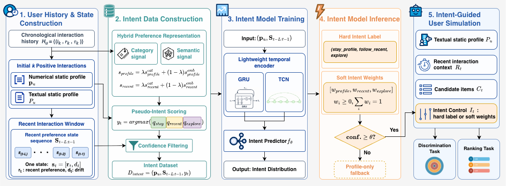

# Beyond Static Profiles: Intent-Aware Behavioural Control for LLM-based User Simulation in Recommendation

---

## Overview

Standard LLM-based user simulators condition on a static user profile, ignoring how real users shift between different decision modes over time. This project introduces a **hybrid profile** that pairs a long-term genre distribution with a dynamically predicted *intent* signal, injected into the LLM prompt alongside quantitative evidence (profile similarity, recent similarity, drift), to make simulated behaviour more faithful to observed behaviour.



---

## Intent Taxonomy

| Intent | When | LLM Behaviour |
|---|---|---|
| `stay_profile` | Low drift — recent taste aligns with long-term profile | Prefer items matching the long-term genre profile |
| `follow_recent` | High drift — recent taste has diverged from long-term profile | Prefer items matching the recent interaction window |
| `explore` | Novelty-seeking — target not represented in either profile | Prefer items from genres underrepresented in both |

---

## Pipeline

```
Raw interactions
      │
      ▼
┌───────────────────┐
│  Data Construction│  data/intent_data_construction_hybrid.py
│  (state & labels) │  → train.npz / intent_eval.npz / sim_eval.npz
└───────────────────┘
      │
      ▼
┌───────────────────┐
│  Intent Model     │  intent_m_train.py
│  GRU / TCN /      │  model/GRU.py, TCN.py, LightTransformer.py
│  Transformer      │  → best_intent_model.pt
└───────────────────┘
      │
      ▼
┌───────────────────┐
│  LLM Simulation   │  discrimination_evaluation_parallel.py
│  & Evaluation     │  ranking_evaluation_parallel.py
│                   │  → discrimination score / NDCG@K / HitRate@K
└───────────────────┘
```

**Evaluation metric:** *discrimination score* — proportion of simulation rounds where the LLM correctly selects the ground-truth positive item from a 1-in-K candidate set (default K=10).

---

## Project Structure

```
IntRecSim_CIKM/
├── config/
│   ├── config_general.yaml          # Dataset paths, LLM settings
│   ├── prompt.yaml                  # LLM prompt templates
│   ├── intent_gru.yaml              # GRU hyperparameters
│   ├── intent_tcn.yaml              # TCN hyperparameters
│   └── intent_transformer.yaml      # Transformer hyperparameters
├── data/
│   ├── dataloader.py                # Dataset loaders (ML-1M, Amazon Book, Beauty)
│   ├── intent_data_construction_hybrid.py   # State + intent label construction
│   └── embedding_utils.py           # Item embedding utilities
├── model/
│   ├── GRU.py                       # GRU (profile initialises h₀)
│   ├── TCN.py                       # Temporal Convolutional Network
│   ├── LightTransformer.py          # Lightweight Transformer
│   ├── intent_models.py             # Model registry and dataset class
│   └── intent_predictor.py          # Inference wrapper
├── figure/
│   └── IntentAwareRecSim.pdf        # Framework overview figure
├── utils/                           # Shared utilities
├── intent_m_train.py                # Intent model training entry point
├── intent_m_train_soft.py           # Soft-label variant training
├── discrimination_evaluation_parallel.py   # LLM discrimination evaluation
└── ranking_evaluation_parallel.py          # LLM ranking evaluation (NDCG@K)
```

---

## Datasets

Experiments run on three public benchmarks:

| Dataset | Domain |
|---|---|
| [MovieLens-1M](https://grouplens.org/datasets/movielens/1m/) | Movies |
| [Amazon Book](https://amazon-reviews-2023.github.io/) | Books |
| [Amazon Beauty](https://amazon-reviews-2023.github.io/) | Cosmetics |

---

## Installation

```bash
pip install torch numpy pandas scikit-learn pyyaml openai tqdm scipy llama-index
```

GPU is recommended for intent model training. The training script auto-detects CUDA → MPS → CPU.

---

## Quick Start

### 1. Build training data

```bash
python data/intent_data_construction_hybrid.py \
    --dataset ml_1m \
    --output-dir output/state_transition/ml_1m
```

### 2. Train the intent model

```bash
# GRU
python intent_m_train.py \
    --config config/intent_gru.yaml \
    --data-dir output/state_transition/ml_1m/intent_data/<run_dir> \
    --output-dir output/state_transition/ml_1m/gru

# TCN
python intent_m_train.py \
    --config config/intent_tcn.yaml \
    --data-dir output/state_transition/ml_1m/intent_data/<run_dir> \
    --model-type tcn
```

Checkpoints are saved to `output/.../ckpt_YYYYMMDD_HHMM/` containing `best_intent_model.pt` and `train_config.json`.

### 3. Run LLM simulation

```bash
# Profile-only baseline
python discrimination_evaluation_parallel.py \
    --data-dir output/state_transition/ml_1m/intent_data/<run_dir>

# Intent-aware (predicted intent, confidence threshold 0.6)
python discrimination_evaluation_parallel.py \
    --data-dir output/state_transition/ml_1m/intent_data/<run_dir> \
    --prompt-mode intent_specific \
    --ckpt output/state_transition/ml_1m/gru/ckpt_<TIMESTAMP>
```

### 4. Ranking evaluation

```bash
python ranking_evaluation_parallel.py \
    -p baseline/APG4Rec_ml_1m.json \
    -d output/state_transition/ml_1m/intent_data/<run_dir> \
    --recent-items \
    -ckpt output/state_transition/ml_1m/gru/ckpt_<TIMESTAMP>
```

---

## Key Design Choices

**State representation** — each timestep is encoded as a 19-d vector: 18-d genre histogram (exponentially-decayed over the last *W* interactions) + 1-d drift scalar (1 − cosine similarity between the recent and long-term profiles).

**Static profile** — L1-normalised genre distribution from a user's first `profile_k` interactions. Fixed throughout; represents stable long-term taste.

**Profile-as-h₀ (GRU)** — the static profile initialises the GRU hidden state across all layers rather than being injected at every step. This lets the profile set the starting context while the recurrent stack learns how the recent sequence deviates from it.

**Confidence-gated fallback** — at inference time, intent is injected into the LLM prompt only when the model's softmax confidence exceeds a per-dataset threshold; otherwise the prompt falls back to `profile_only`.

**Intent label quality** — heuristic labels are assigned by a score formula derived directly from the prompt decision rules. Low-confidence ambiguous samples can be corrected via LLM oracle annotation, yielding the *oracle* label variant used in label-ablation experiments.

---

## Configuration

Edit `config/config_general.yaml` to set dataset paths and the LLM backend. Both OpenAI-compatible and Azure-hosted endpoints are supported via the `llm:` key.

| Key | Description |
|---|---|
| `llm` | LLM identifier, e.g. `azure:gpt-4o-mini` or `gpt-4o` |
| `temperature` | Sampling temperature (default `0.1`) |
| `seed` | Global random seed |
